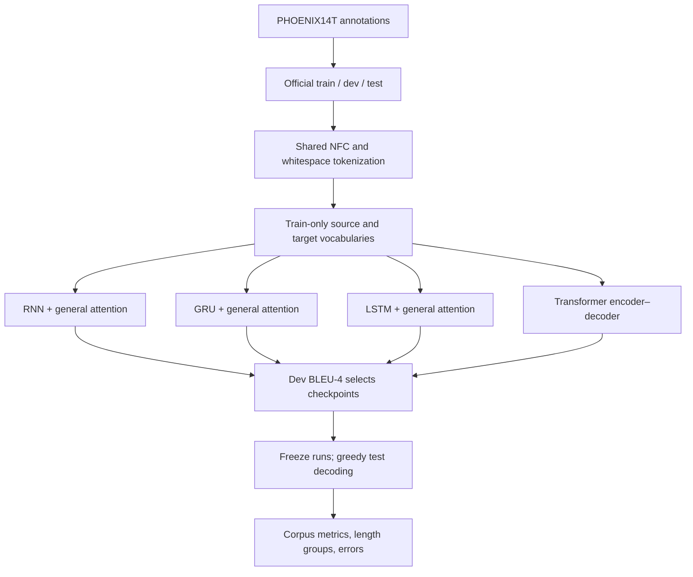

# Model and experiment structure

The source is German text and the target is DGS gloss. Video paths in raw CSVs are ignored.

The diagram summarizes dependency order, not data fitting: test rows are transformed
by the fixed normalizer but never used to build vocabularies, train weights or select
checkpoints. Length-group cutoffs are computed only from training source lengths.

| Detail | RNN / GRU / LSTM | Transformer |
|---|---|---|
| Source representation | Learned embedding | Learned embedding + sinusoidal position |
| Encoder | One unidirectional recurrent layer in pilot | Two self-attention encoder layers |
| Decoder | Same recurrent cell as encoder | Two causal self-attention/cross-attention layers |
| Encoder-to-decoder connection | Final recurrent state initializes decoder | Encoder outputs serve as cross-attention memory |
| Attention | Luong general, encoder padding masked | Multi-head cross-attention, encoder padding masked |
| Target context | Earlier target tokens through recurrence | Earlier target tokens through causal mask |
| Output | Tanh combination of decoder/context, linear projection | Linear projection of decoder states |
| Inference | Greedy, EOS or 80 tokens | Greedy, EOS or 80 tokens |

A gloss prediction is an ordered label sequence. It does not contain a rendered signer,
spatial trajectories, facial expressions, or a complete signed-language utterance.
